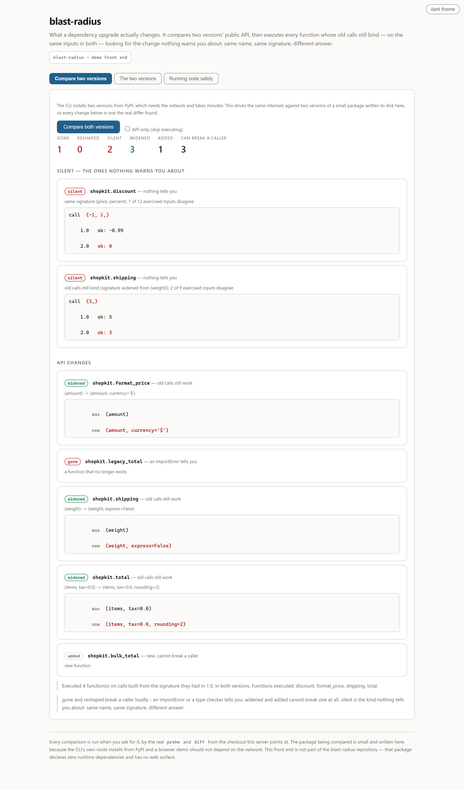
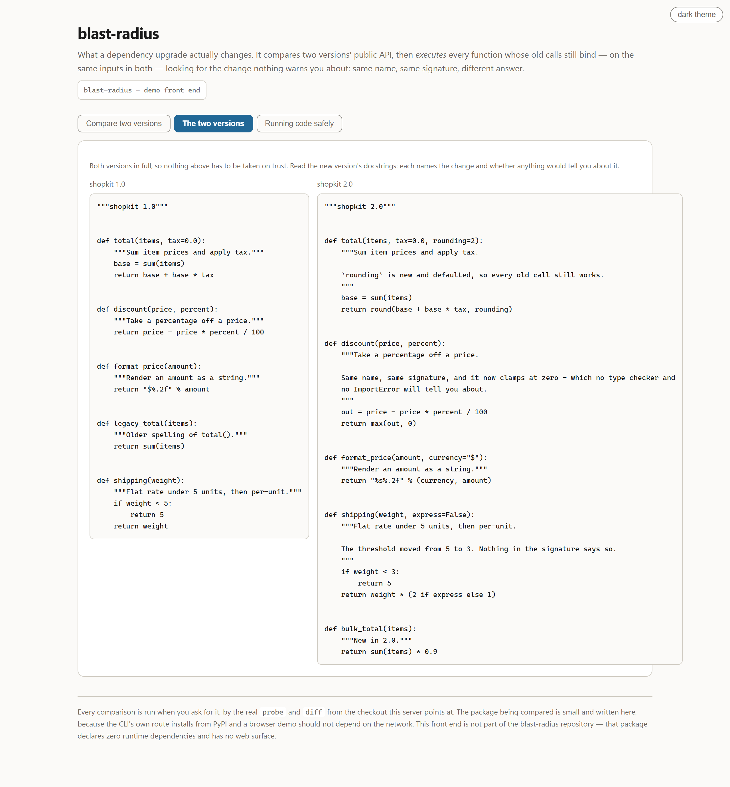
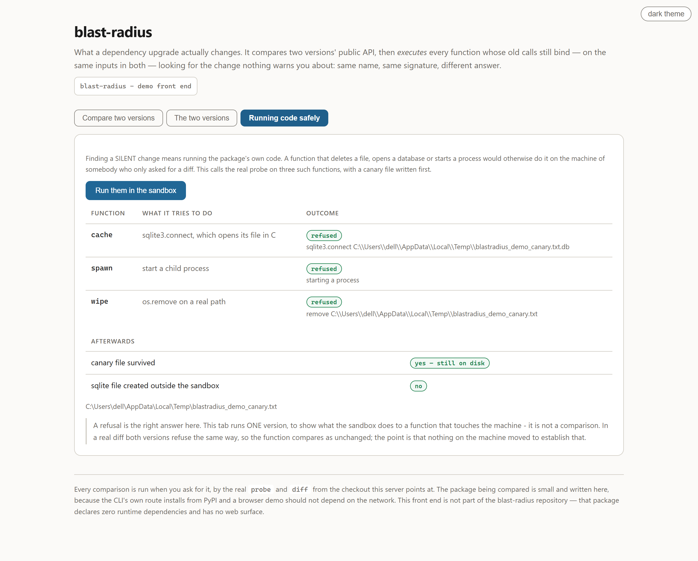

# blast-radius

We built blast-radius to show what a dependency upgrade actually changes: it installs both
versions of a Python package side by side, diffs their public API, then runs every function
whose signature did not change on the same inputs in both versions to catch silent
behaviour changes that no import error or type checker reports. It is for maintainers and
CI pipelines reviewing dependency bumps. No model, no API key, no runtime dependencies.

## What it does

```text
 install BOTH versions ──> read both public surfaces ──┬──> GONE      an ImportError tells you
                                                       ├──> RESHAPED  a type checker tells you
                                                       ├──> WIDENED   nothing to tell: old calls still work
                                                       └──> same shape? ──> EXECUTE both on the same inputs
                                                                                   └──> SILENT  nothing tells you
```

A dependency bump arrives as a version number and a changelog. Neither is evidence. This
sorts what actually changed by **how likely it is to reach production unnoticed**:

| | who tells you |
|---|---|
| a name that vanished (`gone`) | an `ImportError`, at startup, on any CI run |
| a signature that changed incompatibly (`reshaped`) | a type checker, if you run one against a typed dependency |
| a signature that only grew (`widened`) | nobody needs to: every existing call still works |
| **same name, same signature, different answer (`SILENT`)** | **nothing** |

> **A changelog is a claim. This is the diff.**

## Screenshots

A small browser front end drives the package for demonstrations. It is a local demo and is **not part of
the package** — the package has no web surface and no runtime dependencies. Every result on these screens
is a live call into the library.


*The front end as it opens: every feature is a tab, and the page states that nothing on it is precomputed.*


*What changed between two versions, sorted by how quietly it reaches production: gone, reshaped, widened, and silent.*


*The source of both versions, side by side.*


*Both versions executed on the same inputs inside the sandbox that blocks the machine.*

## Sample input / output

`python demo.py` - a real check of `urllib3` 2.2.1 to 2.2.2, a patch release (about five
seconds; it installs both wheels):

```text
installing urllib3==2.2.1 ...
installing urllib3==2.2.2 ...

reading both public surfaces...
  2.2.1: 222 public symbols (reports version 2.2.1)
  2.2.2: 223 public symbols (reports version 2.2.2)

==============================================================================
BLAST RADIUS - urllib3 2.2.1 -> 2.2.2
==============================================================================
  gone          0   an import error at startup
  reshaped      2   a type checker would catch these
  SILENT        -   not checked: the behaviour pass was skipped (--no-behaviour)
  widened       0   not breaking: existing calls still work
  added         1

  reshaped:
    urllib3.BaseHTTPResponse
      was: ...bytes] | None' = None, status: 'int', version: 'int', reason: 'str | None', decode_content: 'bool', ...
      now: ...bytes] | None' = None, status: 'int', version: 'int', version_string: 'str', reason: 'str | None', d...
    urllib3.HTTPResponse
      was: ...status: 'int' = 0, version: 'int' = 0, reason: 'str | None' = None, preload_content: 'bool' = True, ...
      now: ...status: 'int' = 0, version: 'int' = 0, version_string: 'str' = 'HTTP/?', reason: 'str | None' = None...
```

A behaviour-pass example, where the change is silent, is under *One upgrade in depth*
below.

## Results

### 2,937 upgrade pairs: how often does a patch release break public API?

Semantic versioning says a patch release changes nothing a caller can see, and a minor
release only adds. Measured over every pair this tool could install and import, one pair
per bump class per package, taken from **1,389 package names** on PyPI's top-downloads
list - the most recent consecutive release pair of each class published since 2021:

| Bump | Pairs | Broke exported API | Broken symbols | Of exported symbols | Largest pair's share |
|---|---:|---:|---:|---:|---:|
| **patch** | 808 | **20 (2.5%)** | 299 | 299 of 222,729 (0.13%) | 49% |
| **minor** | 830 | **114 (13.7%)** | 732 | 732 of 190,079 (0.39%) | 23% |
| **major** | 532 | **221 (41.5%)** | 13,999 | 13,999 of 121,606 (11.51%) | 21% |
| 0.x-patch | 372 | 29 (7.8%) | 340 | 340 of 43,141 (0.79%) | 51% |
| 0.x-breaking | 346 | 65 (18.8%) | 1,581 | 1,581 of 36,263 (4.36%) | 64% |
| 0.0.z | 49 | 8 (16.3%) | 21 | 21 of 2,567 (0.82%) | 38% |

One pair per class per package, so no package appears twice in a row and 808 patch pairs
are 808 different projects. **3,777 pairs were walked**; 20 are dropped because PyPI's
upload order put the older version second, 52 because a sweep resumed over several days
measured a second pair for a package whose release history moved under it, and **768 could
not be measured** - no importable module, an install that failed, or a surface walk that
did not finish - each with its reason in
[`census-rows.json.gz`](https://github.com/hammasbuilds/blast-radius/blob/main/docs/census-rows.json.gz).
Rebuild the figures from that file alone with `python scripts/census_summary.py --census
docs/census-rows.json.gz`.

**This corrects [SEMVER.md](https://github.com/hammasbuilds/blast-radius/blob/main/docs/SEMVER.md),
which put patch at 15%** from 27 hand-chosen pairs. That page predicted its own bias in
the wrong direction, and its own text says why: all six of its breaks come from two
packages, and those two are in a hand-chosen sweep because their upgrades are worth
writing about.

**Read the last column before the one before it.** A symbol count summed over a cohort is a
number one package can own: `azure-mgmt-resource` 23.1.0 -> 23.1.1 is 49% of every exported
symbol the patch cohort lost, and `meson` 0.63.3 -> 0.64.0 is 64% of the 0.x-breaking
cohort's. The pair-level rates are not exposed to that - one pair is one unit whatever the
size of its surface - which is why they are the headline and the symbol rates are reported
with their largest contributor named.

**`exported` understates what an import can break.** A name counts as exported when it is
in a module's `__all__` or at the package root, which is a proxy for intended API. `scramp`
1.4.18, a **patch** release, drops `MECHANISMS`, `CHANNEL_TYPES` and `MAX_ITERATION_COUNT`
from module scope, so `from scramp.core import MECHANISMS` worked in 1.4.17 and raises now
- and it is counted as internal here, because `scramp/core.py` declares no `__all__`.

**The sweep spans revisions of this tool, and 3,698 of its 3,705 rows do not record which.**
It ran for about a day per full pass and was resumed across several, and rows now carry the
commit that measured them - these do not, because the stamping was added afterwards. One row
reports `BedrockAgentEvent.decoded_body` removed, and `decoded_body` is a `@property`: no
revision in the tree can put that name in a surface at all, which is as clear a
demonstration as the file offers that part of it was written by code that no longer exists.

So the drift is measured rather than argued about. `scripts/census_recheck.py` re-measures a
stratified sample with the current code - 10 pairs per cohort, fixed seed, 60 pairs - and
compares both the verdict each row carries and the symbols behind it:

| | |
|---|---:|
| pairs re-measured | 60 |
| verdicts that changed (would move a rate) | **0** |
| exported symbols that moved without changing a verdict | **0** |
| rows where only internal symbols moved | 2 |

`--plant N` is what makes that zero worth printing: it corrupts N sampled rows with a
removal of a symbol that never existed and reports whether each is contradicted. **Six of
six caught**, and the run exits non-zero if any plant is missed, because a re-check that
cannot find a planted change makes "nothing changed" worthless.

The two internal differences are the constants the walk could not read until this week:
`pyiceberg` 0.11.1 -> 0.12.0 loses four more than the census recorded
(`REST_SCAN_PLANNING_ENABLED` among them), and `aws-lambda-powertools` 2.43.1 -> 3.0.0
loses fourteen fewer - those fourteen being the properties above, which only an older
revision could report.

&#128202; **[Every cohort, every reason, and the per-pair ledger &rarr;](https://github.com/hammasbuilds/blast-radius/blob/main/docs/census-summary.json)**

### A pair-level rate is not a caller-level rate

Every rate above counts a release *pair*: it breaks if one exported name went or was reshaped. A pair that lost one name of
eight hundred counts the same as one that lost three hundred of five hundred, and the damage is concentrated - the **median
breaking pair gives up 2.17%** of its exported surface, the mean 6.52%, and one pair lost all of it.

For a caller importing `k` of a module's `n` exported names with `b` broken, the chance at least one of its names broke is
`1 - C(n-b, k) / C(n, k)`. Averaged over the 1,840 compatibility-promising pairs that export anything:

| the caller imports | chance at least one of its names broke |
|---|---:|
| 1 name | 0.58% |
| 3 names | 1.40% |
| 10 names | 3.45% |

Against a pair-level **8.86%** over those same pairs. **The headline rate is not the chance your upgrade breaks you** - it is
between two and fifteen times larger, depending on how much of a module you touch.

The assumption points one way and it is the wrong way: real callers import the documented, popular names, while breakage sits
in the long tail nobody imports (Gini 0.887). So uniform choice **overstates** caller impact, and the table is an upper bound
under its own model. Rebuild with `python research/semver_compliance.py`.

### So how wrong is it? Measured against real client code

`scripts/caller_census.py` builds a reverse-dependency index from the external top-2,000 PyPI list by reading each package's
declared `requires_dist` - 4,427 packages gain a dependent that way - then downloads the newest archive of up to 25 dependents
per pair and parses it with `ast`. Nothing is imported and nothing is executed; every `from m import x`, every `import m`
followed by `m.x`, and every aliased form is collected as a name that client really uses. Seven release pairs have their broken
names on record (`click` twice, `urllib3` three times, `coverage`, `uvicorn`): **175 observations, 136 clients that use at
least one name and 39 that import the module and name nothing in it**.

| | rate among the 136 clients that use a name |
|---|---:|
| the client names the broken thing itself | **0.2941** |
| *the model, at these clients' own import counts* | *0.3721* |
| the client names an *ancestor* of the broken thing | 0.6029 |
| only the final components agree | 0.6691 |

**Hold the pair and the import count fixed and change only *which* names a client picks** - the assumption itself - and the
model predicts 0.3721 against a measured 0.2941. So uniform choice overstates by a factor of **0.79**: the right direction,
a fifth, not an order of magnitude. These clients import a median of **7** names each, so the `k = 1` row above is the
misleading one to quote rather than the model being wrong.

Two honest limits. The measured rate and the 0.58%-3.45% table are **not** comparable - that table averages over all 1,840
compatibility-promising pairs including the 91% that broke nothing - which is why the comparison is against the model
evaluated on these same clients. And every observation is a static import: a client that imports a broken name and never
reaches the line using it counts as exposed here, which pushes the measured rate up and makes the overstatement a conservative
estimate of itself. `coverage` shows the other end of it - a patch release dropped `CoverageData.update` and **not one of its
25 dependents uses any name from `coverage`**, because it is depended on as a tool rather than as an API.

Rebuild with `python scripts/caller_census.py --from-sweep`. The reverse index is committed as
`docs/caller-index.json.gz` (71 KB), so that reproduces without two thousand metadata requests; drop the file to
rebuild the index itself.

&#128202; **[The compliance rate against the published Maven and Go figures &rarr;](https://github.com/hammasbuilds/blast-radius/blob/main/research/results/semver_compliance.json)**

### 22 upgrade pairs: how often does a patch release break public API?

**API surface only.** This sweep runs `--no-behaviour`, so it sees names that vanished and
signatures that changed, and **cannot detect a single `SILENT` change** — the category the
opening of this README argues nothing else reports. The evidence for `SILENT` is the two
packages in [`RESULTS.md`](https://github.com/hammasbuilds/blast-radius/blob/main/docs/RESULTS.md), not this table.

**Superseded by the census above for the rate**, and kept because 27 pairs are few enough
to name every break, which is what makes them checkable. Measured across widely-pinned
packages:

| Bump | Pairs | Broke exported API | Broken symbols | Of exported symbols |
|---|---:|---:|---:|---:|
| **patch** | 13 | **2 of 13 (15%)** | 3 | 3 of 1,136 (0.26%) |
| **minor** | 6 | **2 of 6 (33%)** | 7 | 7 of 505 (1.4%) |
| major | 3 | **2 of 3** | 29 | 29 of 262 (11%) |

Five of the 27 pairs are **0.x** releases, where [SemVer
§4](https://semver.org/#spec-item-4) promises nothing at all — for a 0.x package the second
component *is* the breaking position — so they are excluded, on the same grounds this study
already excludes calendar-versioned packages. All five were clean, so excluding them
**raises** both headlines. **All six breaks come from two packages**: `click` three and
`urllib3` three, with urllib3's `HTTPResponse` reshape falling in both the patch and the
minor row. The major row is 2 of 3 and gets no percentage.

Small enough to name every instance, which is the point — a percentage with no names behind
it is not checkable. Full method, the three rows' dependence and the per-symbol view: [`docs/SEMVER.md`](https://github.com/hammasbuilds/blast-radius/blob/main/docs/SEMVER.md).

**`urllib3` 2.2.1 → 2.2.2**, a patch release, added a **required** keyword-only parameter to
`BaseHTTPResponse.__init__`, inserted between `version` and `reason`:

```
2.2.1  (*, headers=None, status, version,                 reason, decode_content, ...)
2.2.2  (*, headers=None, status, version, version_string, reason, decode_content, ...)
```

Every subclass calling `super().__init__(...)` now raises `TypeError`. `HTTPResponse` takes
the same parameter positionally, so positional callers have `reason` land silently in
`version_string`.

&#128202; **[The full sweep, every break named &rarr;](https://github.com/hammasbuilds/blast-radius/blob/main/docs/SEMVER.md)**

### One upgrade in depth

`packaging` 21.3 → 24.0, with call sites matched against
[`pypa/build`](https://github.com/pypa/build) at commit `8d1dd6b` (line numbers below
are from that commit):

```
git clone https://github.com/pypa/build pypa-build
git -C pypa-build checkout 8d1dd6b
blast-radius check packaging 21.3 24.0 --used-by pypa-build

  gone          2   an import error at startup
  reshaped      0   a type checker would catch these
  SILENT        4   nothing catches these
  widened       3   not breaking: existing calls still work
  added         9
```

The one worth the whole tool:

```
packaging.version.parse
  same signature (version: str) -> Union[ForwardRef('LegacyVersion'), ForwardRef('Version')]; 3 of 4 exercised inputs disagree
  input : ("x",)
     21.3 : ok: <LegacyVersion('x')>
     24.0 : raise: InvalidVersion: Invalid version: 'x'
```

(Output from Python 3.12. Annotations are printed the way your Python prints them, so
3.14 shows that return type as `ForwardRef('LegacyVersion') | ForwardRef('Version')`; the
counts and verdicts do not change.)

`parse("x")` returned a value and now raises. Same name, same signature. No import fails and
no type checker complains — it takes running both versions to find.

And one that pypa/build is exposed to. `SpecifierSet.contains` only *gained* an optional
parameter, so it is `widened`, not breaking — but because old calls still bind, the
behaviour pass ran it, and it changed underneath:

```
packaging.specifiers.SpecifierSet.contains
  old calls still bind (signature widened from (self, item: Union[packaging.version.Version, packaging.version.LegacyVersion, str], prereleases: Optional[bool] = None) -> bool); 5 of 6 exercised inputs disagree
  input : ("x", True,)
     21.3 : ok: True
     24.0 : raise: InvalidVersion: Invalid version: 'x'
  you may call it at: src/build/_util.py:66
```

pypa/build calls it as `req.specifier.contains(dist.version, prereleases=True)`. The
receiver's type only exists at runtime, so that line is reported as a **possible** call
site, ranked below the proven ones and never enough on its own to fail `--fail-on used`.
The proven ones are `packaging.utils.canonicalize_name` (widened, 3 sites, e.g.
`src/build/env.py:38`) and `packaging.metadata.parse_email` (added,
`src/build/__main__.py:485`) — neither of which can break it.

An upgrade removing forty functions nobody calls is a non-event. The same upgrade touching
one you call in a loop is an incident — so the report sorts by that before anything else.

### What the behaviour pass reaches on a real library

`click` 8.1.6 → 8.1.7 (`blast-radius check click 8.1.6 8.1.7`, a few seconds):

| of 234 stable callables | |
|---|---:|
| not run: the name says it acts on the machine (`launch`, `edit`, `prompt`, `getchar`, `confirm`, `pager`, ...) | 21 |
| **exercised in both versions** | **111** |
| ran, and rejected every generated input | 56 |
| needs an instance this tool could not build | 42 |
| never handed an argument of the right type | 4 |

No API change and no silent change on the inputs tried. The 102 not exercised are reported
by reason rather than as one "could not be called" number: a function this tool never
managed to hand a valid argument is a fact about the tool, and one that ran and refused is a
fact about the package.

See [docs/RESULTS.md](https://github.com/hammasbuilds/blast-radius/blob/main/docs/RESULTS.md) for all three runs; the
JSON each number is read from is committed next to it.

## How it works

**Both versions, side by side, in separate processes.** Two versions of one package cannot
coexist in an interpreter — `sys.modules` is keyed by name, so the second import wins and
every later comparison is one version against itself. Each is probed in its own subprocess,
and **the probe proves which file it loaded** before reporting anything.

**Only the package's own names.** `dir(module)` returns everything reachable, third-party
imports included. Symbols are filtered by `__module__`.

**Callables, and the constants a module declares.** A removed constant is an `ImportError`
at startup exactly as a removed function is, and for its first year this tool read only
routines and classes: the four constants click 8 removes from `click.core` were in no
report. A name counts as a constant when its value is immutable and printable, it is in
`__all__` or spelled in capitals, and it is assigned in that module's own file - the last
condition is what keeps `from socket import AF_INET` out of the package's surface. Only the
NAME is compared: a constant whose value changed is a behaviour change with no witness, and
`__version__` changes every release.

**Call shape, not signature text.** Two signatures are "the same" when their parameter
names, kinds and defaults match. Annotations are excluded on purpose: adding a type hint
cannot break a caller.

**Compatible, not merely different.** A changed call shape is `reshaped` only if some
existing call could trip on it: a parameter removed, renamed, reordered, a default taken
away, a new required keyword. A new parameter with a default, or a positional-only one that
may now be passed by name, is `widened` — listed, never counted as breaking.

**Then execute what every old call still reaches.** Functions that kept their name and a
compatible call shape are run, on the same generated inputs built from the *old*
signature, in both versions. Comparing behaviour across an incompatible signature change
would find differences the signature already explained.

**Executing a package means sandboxing it.** The behaviour pass imports two versions of a
third-party package and calls its functions on generated inputs. That is running somebody
else's code on your machine, so the probe installs a sandbox first: writes are confined to
a scratch root, deletes, renames and metadata changes outside it are refused, the network
is refused except loopback, starting a process is refused, `ctypes` is refused, and reading
from a console raises instead of hanging.

It works in two layers, because one is not enough. Patching names in `os`, `builtins` and
`socket` covers what Python code reaches by those names; it cannot see a library doing its
I/O in C. An audit hook sits underneath, and CPython raises those events from inside the C
implementations, so the hook sees a call however it was reached and whatever reference it
was bound to.

The layering is measured, not asserted. **28 escape routes** are run against the sandbox
by `tests/test_sandbox_os_level.py` and `tests/test_sandbox_c_level.py`, and a third test
checks that this number is the number those two assert. The routes are: `nt`/`posix` (the C module `os` wraps) under every name, references bound before
the sandbox installed, `_socket` under `socket.socket`, `io.FileIO` and `_io` under `io`,
`sqlite3` opening a file in C, and `shutil` operating on paths outside the root. All 28 are refused, and
`tests/test_sandbox_os_level.py` fails if any of them stops being.

None of those are hostile calls. Ordinary library code deletes a stale cache entry, renames
a file into place or touches a timestamp on import. Doing it on the machine of somebody who
only asked for a diff is the thing being prevented. The other half of each test asserts the
probe's own scratch writes, reads, imports and loopback lookups still work — a sandbox that
blocks everything is not safe, it is broken, and the behaviour pass needs all of them on
every run.

**Your code, not your dependencies.** `--used-by` resolves each file's imports, so a
project's own `parse()` is not credited to `packaging`. It skips virtualenvs (any directory
holding `pyvenv.cfg`), `site-packages`, `node_modules`, `.tox`, and `build/` or `dist/`
output that is not itself a package. Files are decoded the way Python decodes them
(PEP 263 coding cookies included), and any file it cannot read or parse is counted and
named in the output rather than skipped in silence.

## Tech stack

- Python 3.11+, standard library only at runtime: `inspect` for signatures, `ast` for
  call-site matching in `--used-by`, `subprocess` probes, an audit hook for the sandbox
- `uv` (or `pip`) to install the two versions into throwaway directories
- pytest and ruff; GitHub Actions also builds the wheel and smoke-tests the installed CLI

## Run it

```bash
pip install git+https://github.com/hammasbuilds/blast-radius

blast-radius check packaging 21.3 24.0
blast-radius check packaging 21.3 24.0 --used-by path/to/your/repo
blast-radius check requests 2.28.0 2.31.0 --no-behaviour    # API diff only, fast
blast-radius check packaging 21.3 24.0 --out report/         # also writes REPORT.md + JSON
blast-radius check packaging 21.3 24.0 --json | jq .counts    # the JSON on stdout
```

`--json` prints the same object as `blast-radius.json` and nothing else on stdout; the
human report moves to stderr. If the run cannot finish, stdout stays empty and the exit
status is 2.

Needs no model, no API key, no GPU. It installs both versions itself, with `uv` if present
and `pip` otherwise, into throwaway directories it cleans up. The name you install and the
name you import may differ (`beautifulsoup4` is `bs4`); it reads the right one from the
package's metadata, and `--import-name` overrides.

The behaviour pass runs the package's own public functions with generated arguments, in a
subprocess that sees only the standard library and the installed version, inside a
throwaway temp dir: starting a process, opening a network connection, reading the console
and writing outside the temp dir are refused, and functions named for acting on the machine
(`launch`, `edit`, `prompt`, ...) are not run. That guards against ordinary library code,
not code written to escape, so run it on packages you would install anyway. A function
that never returns costs one `--timeout` (default 20 s) per version.

### In CI

```bash
# fail the dependency-bump PR if your code references anything that broke
blast-radius check some-lib 1.2.0 1.3.0 --used-by . --fail-on used
```

`--fail-on` takes `gone`, `reshaped`, `silent`, `any` (all three) or `used` (any of the
three that your `--used-by` code references), comma-separated or repeated. `widened` and
`added` never fail a run: they cannot break a caller.

| exit | meaning |
|---:|---|
| 0 | finished; no `--fail-on` condition met |
| 1 | finished; a `--fail-on` condition was met |
| 2 | could not finish: bad arguments, a missing `--used-by` path, an install or import failure |

### From source

```bash
git clone https://github.com/hammasbuilds/blast-radius
cd blast-radius
uv sync                     # the package plus the dev group (pytest, ruff)
uv run pytest -q
uv run python demo.py
```

## Layout

```
src/blast_radius/
  probe.py    import one version in a subprocess; PROVE which file it loaded
  diff.py     gone / reshaped / added, then execute what survived unchanged
  report.py   sorted by what can reach you, silent changes first
  types.py    the kinds of change, and why they are ordered that way
scripts/
  semver_sweep.py       re-runs the 44-pair measurement behind docs/SEMVER.md
  pair_census.py        walks thousands of consecutive release pairs; the raw output is
                        not committed, docs/census-summary.json is
  census_summary.py     reduces that census to the figures quoted, with denominators
  census_table.py       the per-cohort table this README prints
  griffe_comparison.py  installs both versions once and runs griffe and this tool over
                        the same bytes -> docs/griffe-comparison.json
```

391 tests. `pytest --cov=blast_radius` reports **92%** of statements, with one gap worth
naming: the sandbox is a source string executed in the probe's subprocesses, so coverage
cannot see it at all and the 92% says nothing about the part that guards your machine.
That is measured separately, by running 28 escape routes against it.

## Also worth reading

| | |
|---|---|
| &#128200; **[The semver sweep](https://github.com/hammasbuilds/blast-radius/blob/main/docs/SEMVER.md)** | 44 pairs: the 22 that made the promise, and 22 more on 0.x, which promises nothing. Every break named, API surface only |
| &#128202; **[Results](https://github.com/hammasbuilds/blast-radius/blob/main/docs/RESULTS.md)** | All three runs in full, with the limits |
| &#9878; **[Next to griffe](https://github.com/hammasbuilds/blast-radius/blob/main/docs/COMPARISON.md)** | The same two upgrades through mkdocstrings' API differ. It found four removed constants this tool could not see, which is now fixed; it cannot report a behaviour change |
| **[suite-auditor](https://github.com/hammasbuilds/suite-auditor)** | The same differential idea, pointed at a test suite |
| **[pr-referee](https://github.com/hammasbuilds/pr-referee)** | And pointed at a diff |
| **[repo-surgeon](https://github.com/hammasbuilds/repo-surgeon)** | And at a migration, refusing what it cannot prove |

## Licence

MIT - see [LICENSE](https://github.com/hammasbuilds/blast-radius/blob/main/LICENSE).
