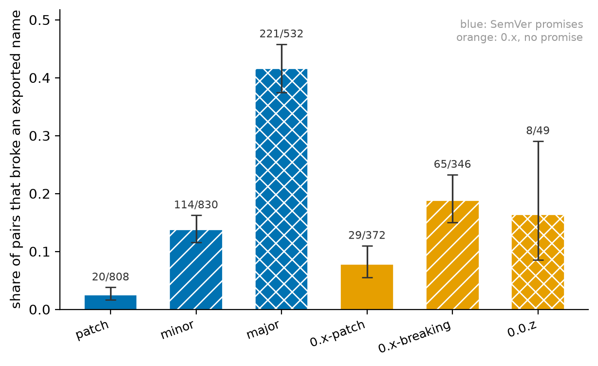
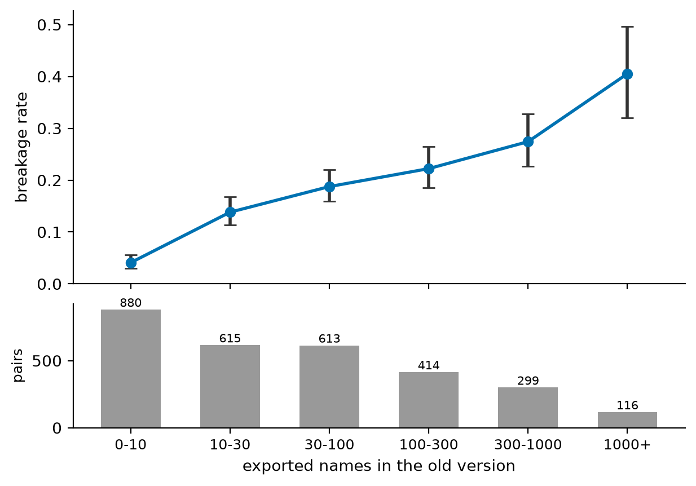
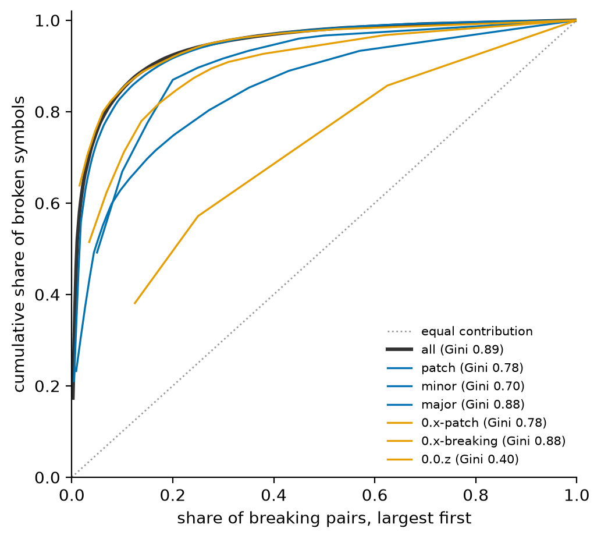
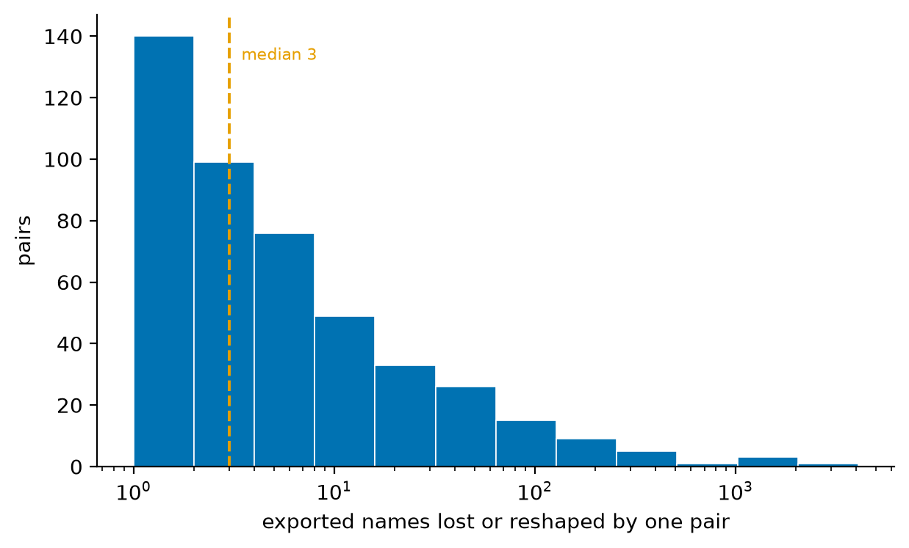
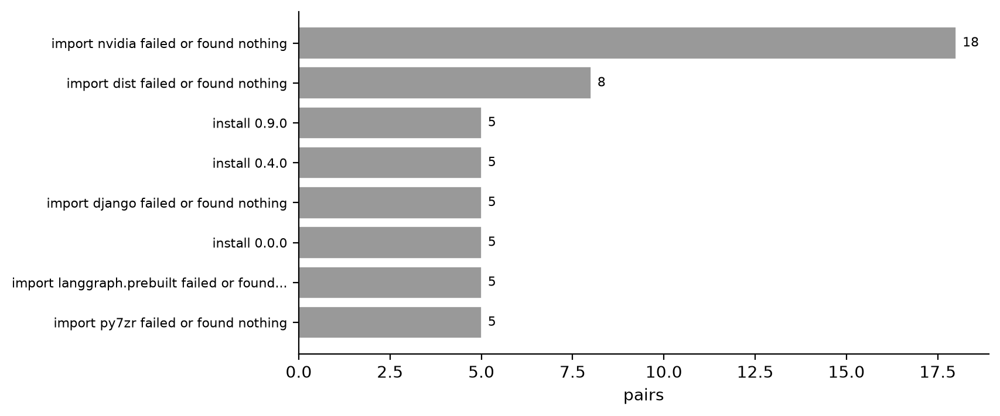

# Abstract

Semantic versioning asks a maintainer to promise that a patch release changes nothing a
caller can observe. Existing studies test that promise by **diffing APIs** — comparing the
names and signatures of two releases — and report violation rates for Maven, npm and
multi-ecosystem corpora. A static diff cannot see a function that keeps its name, keeps its
signature, and returns something different.

We install both versions of a package, import each in an isolated subprocess, and execute
every function whose call shape survived the upgrade on identical generated inputs. Over
**2,937 measured release pairs from 1,202 distinct PyPI packages**, 15.6% broke an exported
name. Patch releases broke one in forty (2.5%, 95% CI [1.6%, 3.8%]); major releases broke
two in five (41.5% [37.4%, 45.7%]).

Five results qualify those rates rather than decorate them. **Breakage rises monotonically
with the size of the exported surface**, from 4.1% [3.0%, 5.6%] for packages exporting ten
names or fewer to 40.5% [32.0%, 49.6%] for packages exporting over a thousand — so a
cohort rate is partly a measurement of API size. **Four of fifteen pairwise cohort
comparisons do not survive multiplicity correction**, so six published percentages are not
six distinguishable populations. And **broken symbols are extremely concentrated** (Gini
0.887; the top 10% of breaking pairs own 84.7% of all broken symbols), so symbol-level
rates are properties of a few packages. Finally, **a pair-level rate is not a caller-level
one**: the median breaking pair gives up 2.17% of its exported surface, and under uniform
symbol choice a caller importing one name from a compatibility-promising upgrade is hit
0.58% of the time against the pair-level 8.86% — a factor of fifteen, in the direction that
makes the headline rate the wrong number to plan an upgrade by. That last estimate is then
**measured against real client code**: the newest archives of 25 declared dependents per
pair, parsed rather than executed, over seven release pairs whose broken names are on
record. Holding the pair and the client's own import count fixed, uniform symbol choice
predicts 0.3721 and real clients come in at **0.2941** — so the assumption points the way
§4.4 says it does and overstates by a fifth, not by an order of magnitude. The clients
import a median of seven names each, which is why the table's `k = 1` row is the misleading
one to quote rather than the model being wrong.

Against `griffe`, a static API differ, the executing approach found four removed public
constants `griffe` reported and our own tool did not — a defect the comparison exposed and
we fixed — while `griffe` cannot express the behavioural category at all.

# 1. Introduction

A dependency bump arrives as a version number and a changelog. Neither is evidence.

The literature on whether version numbers predict breakage is substantial and almost
entirely static. Raemaekers et al. find breaking changes widespread in Maven
Central without regard for semantic versioning [@raemaekers2014]; the replication that
followed finds the same phenomenon at a lower rate, with compliance improving over time
[@breaking-bad]. A study of 384 Maven artifacts reports 67% introducing at least
one semantic-versioning violation. A multi-ecosystem study spanning Maven, PyPI and
RubyGems detects breaking changes by diffing release code and reports API-breaking changes
in 26% of provider packages. On npm, clients recover from breaking changes in about half
of cases, usually by changing the pinned version rather than their code [@npm-breaking]. A
2026 systematic review treats persistent semantic-versioning violation as an open
problem [@slr].

Every one of those detects breakage by comparing declarations. The closest neighbour to
this work is `AexPy` [@aexpy], which is PyPI-specific and detects API breaking changes
between Python releases — and does so by diffing extracted API descriptions, so a
function that keeps its name, its signature and its exception behaviour while returning a
different answer is outside what it can represent.

Two pieces of work do execute. Ruiz et al. [@ruiz-behavioural] update dependencies
automatically and run client test suites, reporting behavioural breaking changes in about
2.3% of updates — the right method, applied to Java. *Who Broke Me?* [@who-broke-me]
assembles BBCBench, 100 behavioural dependency breaks of which 41 are Python, but it is a
**repair benchmark**: the breaks are collected to be fixed, not sampled to estimate a
rate, so it carries no denominator.

The gap is therefore specific, and narrower than "nobody has studied PyPI". Execution-
based measurement of behavioural change exists but not for Python; Python breaking-change
measurement exists but not by execution; a Python behavioural-break *corpus* exists but
not as a census with a population behind it. Our contribution is the intersection: the
category static diffing cannot reach, measured at ecosystem scale with a stated sampling
frame.

**Contributions.**

1. A behavioural-difference method for library upgrades, with a sandbox, a determinism
   check, and an explicit refusal to report a difference it cannot reproduce (§2).
2. A census of 2,937 release pairs across 1,202 PyPI packages, with per-cohort rates,
   Wilson intervals and pairwise significance under Holm correction (§3).
3. Three qualifications of those rates — a monotonic surface-size confound, four
   non-separated cohort pairs, and extreme concentration of symbol-level damage (§4).
4. A comparison against `griffe` that located a real defect in our own tool (§5).

# 2. Method

**Both versions, side by side.** Two versions of one package cannot coexist in an
interpreter: `sys.modules` is keyed by name, so the second import wins and every later
comparison is one version against itself. Each version is installed into its own directory
and probed in its own subprocess, and the probe proves which file it loaded before
reporting anything — a `sys.path` entry that does not exist is silently ignored by Python,
which previously made a known-breaking upgrade report "nothing changed".

**Four kinds of change,** ordered by how quietly each reaches production: `gone` (an
`ImportError` at startup), `reshaped` (a type checker catches it), `widened` (no existing
call can trip on it; never counted as breaking), and `SILENT` — same name, same call shape,
different answer.

**Call shape, not signature text.** Two signatures are the same when their parameter names,
kinds and defaults match. Annotations are excluded deliberately: adding a type hint cannot
break a caller. Comparing signature *text* instead reported 795 breaking changes for one
upgrade that added type hints, and starved the behavioural pass of candidates.

**What the behavioural pass refuses to claim.** A difference is reported only if it
reproduces when re-run; a function that disagrees with itself is recorded as
non-deterministic, not silent. Differences that occur only where one version rejects a
generated argument as the wrong type are reported separately and never counted. Both
reasons are published per finding.

**Constants.** A removed module-level constant is an `ImportError` at startup exactly as a
removed function is. We read a name as a constant when its value is immutable and
printable, it is in `__all__` or spelled in capitals, and it is assigned in that module's
own file — the last condition keeps re-exported third-party names out of a package's
surface. Only the name is compared; a changed value is a behavioural change with no
witness.

# 3. The census

Pairs are the most recent consecutive release pair of each bump class per package,
published since 2021-01-01, from 1,389 package names on PyPI's top-downloads list. **3,777
pairs were walked.** 20 are dropped because PyPI's upload order placed the older version
second; 52 because a sweep resumed over several days measured a second pair for a package
already represented in its cohort, leaving 3,705 rows. Of those, 768 could not be
measured — no importable module, a failed install, or a surface walk that did not
finish. **2,937 pairs were measured.**

| Bump | Breaking / measured | Rate | Wilson 95% |
|---|---:|---:|---|
| patch | 20 / 808 | 0.025 | [0.016, 0.038] |
| minor | 114 / 830 | 0.137 | [0.116, 0.163] |
| major | 221 / 532 | 0.415 | [0.374, 0.457] |
| 0.x-patch | 29 / 372 | 0.078 | [0.055, 0.110] |
| 0.x-breaking | 65 / 346 | 0.188 | [0.150, 0.233] |
| 0.0.z | 8 / 49 | 0.163 | [0.085, 0.292] |

The ordinal claim holds strongly: patch vs minor $p = 2.1\times10^{-17}$, minor vs major
$p = 6.3\times10^{-31}$ (Fisher exact, Holm-corrected over fifteen comparisons).

## 3.1 The same question in other ecosystems

The rate above has no meaning without something to place it against, and three ecosystems
have been measured.

| ecosystem | what was measured | rate |
|---|---|---:|
| Maven (Java) | breaking upgrades, all levels, original study [@raemaekers2014] | 30.0% |
| Maven (Java) | **non-major** upgrades that break, 119,879 upgrades [@breaking-bad] | 20.1% |
| Maven (Java) | patch upgrades that break [@breaking-bad] | 14.6% |
| Go | non-major upgrades introducing a breaking change, 124K libraries [@go-semver] | 28.6% |
| npm | dependent releases impacted by a breaking change in a non-major update [@npm-breaking] | ~14% |
| **PyPI (this work)** | **non-major upgrades (patch + minor) losing or reshaping an exported name** | **8.2%** |
| **PyPI (this work)** | **all upgrades, every cohort** | **15.6%** |

**PyPI's non-major rate is the lowest in the table, and the detector is the first
explanation to rule out, not the last.** Each row measures something different. Maven's
counts releases; Go's counts upgrades by signature diffing; npm's counts *client*
manifestation, so a break nobody depends on is not counted. Ours counts an exported name
that is **`gone` or `reshaped`** under execution — `widened`, a signature that only grew,
is explicitly not breaking here, because every existing call still binds — which is
narrower than "any breaking change":
a changed exception type, a changed default, a changed return value under the same
signature is a break this row does not contain, and §2 is explicit that the behavioural
category is reported separately for exactly that reason. A narrower definition produces a
smaller number, and the 8.2% should be read as a lower bound on PyPI's non-major breakage
rather than as evidence that PyPI breaks less than Go.

What *is* comparable across the rows is the shape, and here the literature is unusually
direct. Raemaekers et al. report Maven's major and minor upgrades breaking at **35.9%**
and **35.7%** respectively, and the replication says so in as many words: "the original
study reports that there are as many breaking major upgrades as breaking minor upgrades"
[@breaking-bad, Table 5.1]. On PyPI they do not. **Minor 13.7% against major 41.5%**, a
factor of **three**, with non-overlapping Wilson intervals and $p = 6.3\times10^{-31}$ in
the table above.

The replication's own larger corpus separates the levels too - major 61.8%, minor 37.9%,
patch 14.6% - so the similarity belongs to the original study's corpus rather than to
Maven as such. The honest form of the comparison is therefore that PyPI separates its
levels *more sharply than either Maven measurement*, not that Maven fails to separate
them at all. Whatever else differs, PyPI's major releases carry breakage its minor
releases do not, and that is a difference in the thing being described rather than in how
it is counted.

# 4. Five qualifications

**4.1 Surface size is a confound, and it is monotonic.**

| Exported names | Breaking / measured | Rate | Wilson 95% |
|---|---:|---:|---|
| 0–10 | 36 / 880 | 0.041 | [0.030, 0.056] |
| 10–30 | 85 / 615 | 0.138 | [0.113, 0.168] |
| 30–100 | 115 / 613 | 0.188 | [0.159, 0.220] |
| 100–300 | 92 / 414 | 0.222 | [0.185, 0.265] |
| 300–1000 | 82 / 299 | 0.274 | [0.227, 0.327] |
| 1000+ | 47 / 116 | 0.405 | [0.320, 0.496] |

A tenfold spread with non-overlapping intervals end to end. A package exporting a thousand
names has more opportunities to lose one, so any cohort comparison is partly a comparison
of API sizes. Median surface is 28 names; p95 is 849; the largest is 22,713.

**4.2 Four of fifteen cohort pairs are not separated.** After Holm correction, `minor vs
0.x-breaking`, `0.x-patch vs 0.0.z`, `minor vs 0.0.z` and `0.x-breaking vs 0.0.z` are not
distinguishable at $\alpha = 0.05$. Every one of them involves a cohort with few measured
pairs. Printing six percentages side by side implies six populations; there are not six.

**4.3 Symbol-level damage is owned by a handful of pairs.** Gini 0.887 over 457 breaking
pairs; the top 10% account for 84.7% of all broken symbols. Per cohort the largest single
pair owns 63.8% (`0.x-breaking`), 51.5% (`0.x-patch`) and 49.2% (`patch`) of that cohort's
symbols. The distribution of damage is heavy-tailed: the median breaking pair loses a
handful of names and the largest loses thousands, so a mean describes no pair in it. **We
therefore report pair-level rates as the headline and never a symbol-level rate without its
largest contributor named.**

**4.4 A caller is not a package, and the gap between them is a factor of fourteen.** Every
rate above counts a release *pair*: the pair breaks if one exported name went or was
reshaped. That is the right unit for asking whether maintainers keep the semantic-versioning
promise, and the wrong one for the question a reader actually arrives with, which is whether
*their* upgrade will break. A pair that lost one exported name of eight hundred is counted
identically to one that lost three hundred of five hundred, and §4.3 has already shown the
damage is concentrated: the median breaking pair gives up **2.17%** of its exported surface,
the mean 6.52%, and at the other end there is a pair that lost **100%** of it.

The npm row in §3.1 is the only published figure that counts client manifestation rather than
API change. §4.5 measures the quantity against real client code on seven pairs and finds
this model overstating by a factor of 0.79; what follows is the model it is measured against. What can be done without one is to state the arithmetic. For a caller importing
$k$ of a module's $n$ exported names, with $b$ of them broken, the chance at least one of the
caller's names is among them is, under uniform choice without replacement,

$$1 - \binom{n-b}{k} \Big/ \binom{n}{k}$$

Averaged over the 1,840 compatibility-promising pairs that export anything:

| the caller imports | chance at least one of its names broke |
|---|---:|
| 1 name | 0.58% |
| 3 names | 1.40% |
| 10 names | 3.45% |

Against an API-level 8.86% over the same 1,840 pairs. So the headline rate and the
caller-level estimate differ by between a factor of two and a factor of fifteen, depending
on how much of a module a caller touches, and **the API-level rate is not an estimate of the
chance an upgrade breaks a given caller.** It was never offered as one, but it is the reading
a reader will take unless the difference is printed, and until now it was not.

Two things keep this an estimate rather than a measurement.

*The uniform assumption points one way, and it is the wrong way.* Real callers do not sample
a module's names uniformly; they import the documented, popular ones. §4.5 confirms the
direction and sizes it: on seven measured pairs the model predicts 0.3721 and real clients
come in at 0.2941. Breakage is
concentrated in the long tail — Gini 0.887 — and the tail is exactly what nobody imports. So
uniform choice spreads the broken names across the whole surface and **overstates** the
chance a real caller is hit. The table is an upper bound on caller impact under its own
model.

Two published client-level figures sit near it and neither is the same quantity as any
row of it. [@breaking-bad] finds **7.9% of Maven clients actually impacted**, over real
client code and all non-major upgrades, because most breaking changes touch declarations
no client uses - which is the same mechanism §4.4 measures as a Gini of 0.887 over broken
symbols, arrived at independently. [@go-semver] finds **33.3% of Go clients may be
affected**, which is a possibility rather than an observation. Mine is per upgrade and per
import count, so it is comparable to neither directly. An earlier draft of this paragraph
attributed the 7.9% to the Go study; it is Maven's, and Go's client figure is the 33.3%.

*The denominator moved.* These 1,840 pairs are the 2,010 of §3 minus the 170 that export no
names at all. A module exporting nothing cannot break an exported name, so excluding them
raises the API-level rate from 8.11% to 8.86% on an unchanged numerator of 163. Both
denominators are correct for their question and they are not interchangeable;
`research/results/semver_compliance.json` records all three counts so the 0.75-point step is
attributable rather than mysterious.

**4.5 Measured against real clients, the model overstates by a fifth.** §4.4 says plainly
that nothing in this paper looks at a client, and that uniform symbol choice therefore makes
its table an upper bound rather than an estimate. `scripts/caller_census.py` looks at
clients, and the direction §4.4 asserted is the direction the data shows — which is worth
saying because the size turns out to be modest, not an order of magnitude.

The method is the one the Go study uses, in miniature. A reverse-dependency index is built
from the **external** top-2,000 PyPI list by reading each package's declared
`requires_dist`, so a client enters by declaring the dependency rather than by being chosen
here; 4,427 packages acquire at least one dependent that way. For each release pair whose
broken exported names are on record, up to 25 of its dependents have their newest archive
downloaded and parsed with `ast` — never imported, never executed — and every
`from m import x`, every `import m` followed by `m.x`, and every aliased form of both is
collected as a name that client actually uses. A (pair, client) observation is a hit when
one of those names is among the names that broke.

Seven pairs carry their broken names: `click` twice, `urllib3` three times, `coverage` and
`uvicorn`. 175 observations, of which **136 clients use at least one name** from the module
and **39 import it and touch nothing** — a client that imports a module and names nothing
in it cannot be broken by a name going away, and counting it as a user would be the uniform
assumption in another form.

Matching has a choice in it and the choice moves the answer, so three nested tiers are
reported rather than one:

| | rate among the 136 clients that use a name | what it counts |
|---|---:|---|
| exact | **0.2941** | the client names the broken thing itself |
| *the model, at these clients' own k* | *0.3721* | *§4.4's formula, n and b from the pair, k from the client* |
| enclosing | 0.6029 | the client names an *ancestor* of the broken thing |
| loose | 0.6691 | only the final components agree |

**The comparable number is the middle row, and it is the point of the exercise.** §4.4's
published 0.58%–3.45% is an average over all 1,840 compatibility-promising pairs, including
the 91% that broke nothing at all, evaluated at $k = 1, 3, 10$. Neither the population nor
the $k$ matches these clients, so comparing 29% against 3.45% would be comparing two
different questions. Holding the pair and the $k$ fixed and changing only *which* names a
client picks — which is exactly the assumption §4.4 names — the model predicts **0.3721**
and the measurement is **0.2941**: uniform choice overstates by a factor of **0.79**.

Two further things the measurement settles:

*The $k$ in the table was the weakest part of it, not the uniform assumption.* These clients
import a median of **7** names from the module and a mean of 9.6, with one reaching 40. The
table's three rows at 1, 3 and 10 bracket that, so the arithmetic was asking a reasonable
question; what made 0.58% look like a reassuring number was reading the first row.

*The matcher's bracket straddles the model.* 0.2941 and 0.6029 are the two defensible
readings of the same observations, and 0.3721 lies between them. So the measurement
**bounds** the model rather than replacing it, and a paper claiming either that the model is
confirmed or that it is refuted would be choosing an end of its own bracket. The gap between
the two tiers is one question the import graph cannot answer: `click.Path.coerce_path_result`
was reshaped, and a client holding `click.Path` is exposed if it subclasses the class or
calls that member and not otherwise.

Three limits, stated rather than discovered later. The seven pairs are the hand-picked ones
of `docs/semver-sweep.json`, chosen before this measurement existed but chosen by hand, and
they are far more depended-upon than the median census package — so this answers "how wrong
is the model on well-used packages" and not "what is the rate across the ecosystem". Every
observation is a **static** import: a client that imports a broken name and never reaches
the line that uses it counts as exposed here and would not break in practice, which pushes
the measured rate up and so makes the overstatement a conservative estimate of itself. And
the per-cohort picture is uninformative at this sample size for the clearest possible
reason — `coverage` 7.5.0→7.5.4 lost `CoverageData.update`, and **not one of its 25
dependents uses any name from `coverage` at all**. It is depended on as a tool, not as an
API, and a patch release breaking one of its names reaches none of them.

# 5. Comparison with a static differ

`griffe` and this tool were run over the same two installed directories for `click`
7.1.2→8.1.7 and `urllib3` 2.2.1→2.2.2. `griffe` reported 104 and 13 findings; this tool
reported 16 gone / 11 reshaped / 9 widened / 4 silent and 2 reshaped / 1 silent / 1 added.
The counts are not comparable: 40 of `griffe`'s click findings are positional parameters
whose index moved, and 15 are the word `object` dropped from a Python-2-era base list — all
15 verified against click 7.1.2's source.

Two findings matter.

**`griffe` found four removed public constants that this tool could not see.**
`click.core.SUBCOMMAND_METAVAR` and three others are strings; our surface walk described a
name only when it was a routine or a class. `from click.core import SUBCOMMAND_METAVAR` is
an `ImportError` under click 8, and it appeared in no report this tool had ever produced.
Nothing in our own test suite could have found it: a tool that reads only callables passes
every test about callables. Fixed; `gone` moved 12→16.

**The behavioural category is outside what a static differ can express.** In the patch
release `urllib3` 2.2.1→2.2.2, `HTTPResponse.read` keeps its name and signature and returns
`None` where it previously raised `RuntimeError` on one of twelve exercised inputs.
`griffe` never imports the package and so cannot call anything.

# 6. Threats to validity

**Surface size confounds every cohort rate** (§4.1), and we do not adjust for it: we report
it. An adjusted rate would need a model of how surface size and release discipline relate,
which this design cannot identify.

**The denominator is chosen by what could be measured.** 768 of 3,705 rows produced no
comparison, and the reasons are not independent of the packages — a stub-only distribution
differs from one whose surface walk exceeded its budget. Rates are over measured pairs and
the exclusions are published with their reasons.

**The census spans revisions of this tool.** It was resumed over several days and 3,698 of
3,705 rows do not record which revision measured them. One row reports
`BedrockAgentEvent.decoded_body` removed, and `decoded_body` is a `@property` — which the
current walk cannot report at all, demonstrating that part of the file was produced by code
no longer in the tree. To bound this, 60 pairs were re-measured at a single revision (10
per cohort, fixed seed): **0 verdict changes, 0 exported-symbol changes, 2 rows where only
internal symbols moved.** The re-check's sensitivity was established by planting false
removals in sampled rows — six of six caught.

**Generated inputs are not real call sites.** The behavioural pass builds arguments from
the old signature; a function whose difference only appears on inputs the generator never
produces is missed. This bounds recall, not precision: every reported difference carries a
witness.

**Single machine, single interpreter, Windows.** Three of the eight flakiness-adjacent
arms available elsewhere do not run here, and one package (ansible, 6,846 modules) could
not be walked within any budget tried.

> **On the numbers in §4.** An earlier draft quoted these from a research module that
> loaded the per-pair ledger without the two filters the published summary applies —
> dropping pairs whose `new` version predates its `old`, and keeping one pair per package
> per cohort. It described 2,997 pairs where the rest of the paper describes 2,937, with
> the patch cohort at 23/830 rather than 20/808. The module now imports both filters from
> the summariser rather than reproducing them, and every figure in §4 was regenerated.
>
> The title, the abstract and contribution 2 were **not** regenerated at the same time
> and carried 2,997 for a further revision — the paper was called *A 2,997-Pair Census*
> while §6 explained that 2,997 was wrong. A correction applied to the section that
> produced the error and not to the places that quote it is the failure mode this note
> exists to record, and it has now happened twice in one paper. The package count was
> wrong by two in the same places. `tests/test_census_numbers.py` now reads both out of
> the ledger.

# 7. Figures

All five rebuild from `docs/census-rows.json.gz` via `python research/run_all.py`.
Nothing is encoded by colour alone, and every caption states its denominator.

**Figure 1.** Breakage rate by bump class over 2,937 measured release pairs, with Wilson
95% intervals. Counts above each bar are breaking pairs over measured pairs. The y-axis
starts at zero.

**Figure 2.** Breakage rate against the size of the exported surface. The rate moves from
4.1% in the smallest bucket to 40.5% in the largest, so surface size is a confound for any
cohort comparison and is reported beside it rather than adjusted away (§4).

**Figure 3.** Concentration of broken exported symbols. Over all cohorts, 85% of symbols
come from the top 10% of breaking pairs (Gini 0.89, 457 pairs). This is why the pair-level
rate is the headline and the symbol-level rate is reported with its largest contributor
named.

**Figure 4.** How much a breaking pair breaks, over 457 breaking pairs, log x-axis with
doubling bins. The median breaking pair loses 3 exported names and 46% lose two or fewer,
while the largest loses 2,941. A mean over this distribution would describe no pair in it.

**Figure 5.** Why 780 of 3,777 pairs produced no surface comparison, top eight reasons. A
rate over the measured pairs alone is a rate over a denominator this census chose, and the
reasons are not independent of the packages: a package with no importable module is a
different exclusion from one whose walk did not finish.

# 8. Reproducibility

`docs/census-rows.json.gz` (115 KB) holds one row per pair with counts and reasons and no
symbol names. `python scripts/census_summary.py --census docs/census-rows.json.gz`
reproduces the published summary **byte-identically**, which is checked by a test, so every
figure and rate in this paper rebuilds from the repository without the 4.3 MB raw artefact.
The comparison against `griffe` rebuilds via `scripts/griffe_comparison.py`, which installs
both versions and both tools.

# References

- [@raemaekers2014] Raemaekers, S., van Deursen, A. and Visser, J. *Semantic Versioning versus Breaking Changes: A Study of the Maven Repository.* SCAM 2014. Extended as *Semantic versioning and impact of breaking changes in the Maven repository*, Journal of Systems and Software 129, 2017. **Not read directly** - ScienceDirect refuses automated access and the TU Delft copy does not respond - so every figure attributed to it here comes from the replication's reproduction of it in [@breaking-bad, Table 5.1]: 80,589 upgrades, **30.0% breaking overall**, **major 35.9% against minor 35.7%**, patch 23.8%, non-major 29.0%.
- [@breaking-bad] Ochoa, L., Degueule, T., Falleri, J.-R. and Vinju, J. *Breaking Bad? Semantic Versioning and Impact of Breaking Changes in Maven Central.* Empirical Software Engineering 27, 2022; arXiv:2110.07889. **Read in full** from the arXiv PDF. 119,879 upgrades and 293,817 clients. **83.4% of *all* upgrades comply** - not of non-major ones - and the paper states the non-major figure directly: **20.1% of non-major upgrades break**. Per level: major 61.8%, minor 37.9%, patch 14.6%, initial development 26.7%. Table 5.1 also reproduces the original study's results, which is this paper's source for them. **Only 7.9% of clients are actually impacted**, because most breaking changes touch declarations no client uses.
- [@npm-breaking] *I Depended on You and You Broke Me: An Empirical Study of Manifesting Breaking Changes in Client Packages.* arXiv:2301.04563. In npm, **about 12% of dependent packages and 14% of their releases were impacted by a breaking change** during updates of non-major releases of their dependencies.
- [@go-semver] *A Large-Scale Empirical Study on Semantic Versioning in Golang Ecosystem.* arXiv:2309.02894. 124K third-party libraries and 532K client programs; 86.3% of library upgrades follow semantic versioning, **28.6% of non-major upgrades introduce breaking changes**, and 33.3% of downstream clients may be affected.
- [@slr] *Breaking Changes in Software Ecosystems: A Systematic Literature Review.* arXiv:2605.24397.
- [@aexpy] Du, X. and Ma, J. *AexPy: Detecting API Breaking Changes in Python Packages.* ISSRE 2022.
- [@ruiz-behavioural] Ruiz, D. et al. *Understanding the Impact of APIs Behavioral Breaking Changes on Client Applications.* Proc. ACM Softw. Eng., 2024. <https://doi.org/10.1145/3643782>
- [@who-broke-me] *Who Broke Me? Execution-Guided Repair of Behavioral Dependency Breaks.* arXiv:2610.09267. Introduces BBCBench (100 breaks, 41 Python).
- *griffe* — API differ, mkdocstrings. <https://mkdocstrings.github.io/griffe/>

> **Citation status.** A previous draft of this note recorded that the literature search
> had found **no PyPI-specific semantic-versioning study**, and made the novelty claim in
> §1 rest on that absence. That was wrong: `AexPy` [@aexpy] is PyPI-specific. A second
> search also found execution-based behavioural-break measurement [@ruiz-behavioural],
> in Java, and a Python behavioural-break benchmark [@who-broke-me] with no denominator.
> §1 has been rewritten to claim the intersection those three leave open rather than an
> absence, which is both true and a narrower claim.
>
> **§3.1's cross-ecosystem table has now been checked against the sources, and it was
> wrong in three ways.** The sentence it leans on hardest did survive; the apparatus
> around it did not.
>
> *A reference that does not exist.* @maven-replication was listed as *Breaking changes
> and semantic versioning in Maven Central: a replication study*, Journal of Systems and
> Software, 2023, and cited twice. **No such paper is in OpenAlex or Crossref.** It
> appears to be a conflation of three real ones: Raemaekers et al. at SCAM 2014, their
> extended version in JSS 129 (2017), and Ochoa et al.'s actual replication in EMSE 27
> (2022), which this paper already cites as @breaking-bad. The entry is removed and its
> two citations reassigned to the papers that carry the claims.
>
> *A rate derived by the wrong subtraction.* The table gave Maven's non-major breaking
> rate as "100% less the reported 83.4%", i.e. 16.6%. The 83.4% is **over all upgrades**,
> not non-major ones, and @breaking-bad states the non-major figure directly: **20.1%**.
> The table now quotes it rather than deriving it.
>
> *An arithmetic slip.* "A factor of five" for minor 13.7% against major 41.5% is a
> factor of three.
>
> What held, and is now first-hand: @breaking-bad was read in full from its arXiv PDF,
> and its Table 5.1 reproduces the original study's per-level results — major **35.9%**
> against minor **35.7%** — with the text stating plainly that "the original study reports
> that there are as many breaking major upgrades as breaking minor upgrades". That is the
> contrast §3.1 draws, and it is now cited to the table that contains it. Raemaekers et
> al. themselves remain **unread**: ScienceDirect refuses automated access and the TU
> Delft copy does not respond, so every figure attributed to them here is explicitly
> taken from the replication's reproduction of their work rather than from them.
>
> The Go figures (86.3% compliance, 28.6% of non-major upgrades, 124K libraries and 532K
> clients, 33.3% of clients possibly affected) and the npm figures (about 12% of dependent
> packages and 14% of their releases) were re-checked against the two papers' abstracts
> and are exact.
>
> The remaining references are quoted from search summaries rather than full texts and
> must each be read before submission. `AexPy`, `@ruiz-behavioural` and `@who-broke-me`
> are summarised from abstracts and search results; in particular the 2.3% figure and
> the 41-Python-case count are second-hand and load-bearing for the paragraph that cites
> them.
